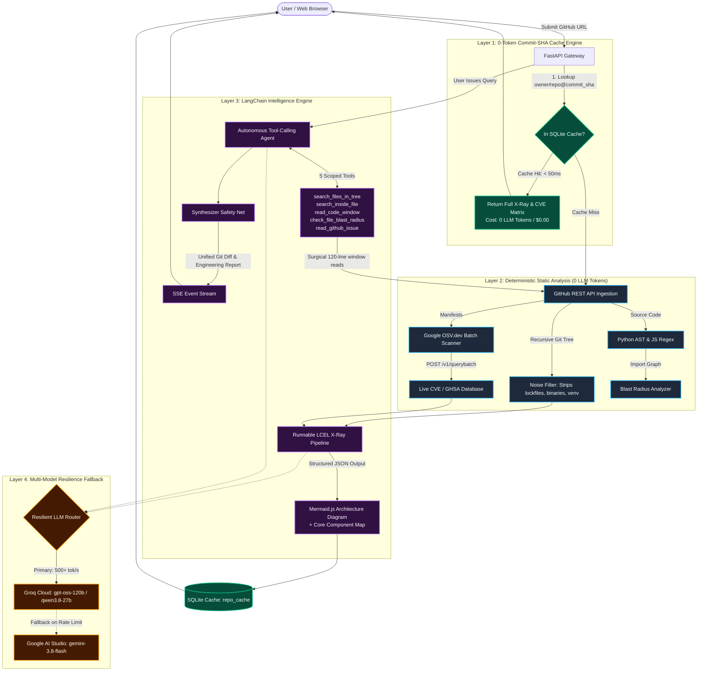

<div align="center">

# 🚀 RepoPilot
### Autonomous GitHub Codebase X-Ray, Live CVE Auditor & Issue-to-PR Agent
**Full-stack developer intelligence on $0 LLM infrastructure via Commit-SHA Caching & Surgical Tool-Calling.**

[](https://python.org)
[](https://fastapi.tiangolo.com)
[](https://langchain.com)
[](https://groq.com)
[](https://aistudio.google.com)
[-34A853.svg)](https://osv.dev)
[](LICENSE)

</div>

---

## 🏛️ Grand System Architecture

Instead of dumping 50,000 lines of code into an LLM context window—which exhausts token limits, hits rate-limit ceilings, and hallucinates—RepoPilot combines **deterministic static analysis**, **live security databases**, **immutable Commit-SHA caching**, and a **surgical ReAct tool-calling agent**:



---

## ⚡ Four End-to-End Execution Pipelines

### 🔄 Pipeline A: 0-Token Commit-SHA Cache Check (0ms LLM Latency)
1. User submits a repository URL (e.g. `https://github.com/psf/requests`).
2. FastAPI queries the GitHub API for the repository's latest `commit_sha` on the default branch.
3. If `{owner}/{repo}@{commit_sha}` exists in `repopilot_cache.db`, the entire architecture diagram and dependency audit are returned in **< 10ms with zero LLM tokens spent**.
4. When the repo maintainer pushes new code, the SHA changes automatically, triggering a fresh cache-miss analysis.

### 📐 Pipeline B: Parallel Architecture X-Ray & Onboarding Synthesis
1. Concurrently retrieves repo metadata, language byte counts, noise-filtered file tree (capped at 350 files), and `README.md`.
2. Invokes an LCEL pipeline with `PydanticOutputParser` enforcing strict JSON schema adherence.
3. Generates an interactive **Mermaid.js flowchart (`graph TD`)**, **4–6 core component nodes**, and a **5-minute developer onboarding guide**.

### 🛡️ Pipeline C: Deterministic Manifest Parsing & Live CVE Audit
1. Parses `requirements.txt` or `package.json` into exact `(package, version, ecosystem)` tuples via deterministic regex/JSON parsers.
2. Sends a **single batch POST request** to `https://api.osv.dev/v1/querybatch` (Google OSV.dev).
3. Returns live CVE & GHSA vulnerability IDs at **$0 cost with zero API keys required**.
4. LangChain categorizes each package by architectural role (*Networking, Auth, Database, UI*) and recommends concrete upgrade commands.

### 🤖 Pipeline D: Surgical Issue-to-PR Tool-Calling Agent
1. User provides a GitHub Issue number or technical query (e.g., *"How are cookies merged during `Session.request`?"*).
2. LangChain initializes `create_tool_calling_agent` bound to 5 repository tools:
   * `search_files_in_tree`: In-memory path search (0 external API calls).
   * `search_inside_file`: Scans specific files like `Ctrl + F` and returns line numbers with context.
   * `read_code_window`: Slices max 120 lines around target symbols.
   * `check_file_blast_radius`: Analyzes downstream file imports using Python AST.
   * `read_github_issue`: Fetches issue descriptions and maintainer comments.
3. **Synthesizer Safety Net**: If the agent uses its tool budget gathering clues, the Synthesizer automatically writes a complete engineering report and unified code diff patch from the collected evidence.
4. Streams execution logs and diffs in real-time over **Server-Sent Events (SSE)**.

---

## 🛠️ Scoped Repository Tools

| Tool Name | Arguments | Backend Action | Token Protection Rule |
| :--- | :--- | :--- | :--- |
| `search_files_in_tree` | `keyword: str` | Fast in-memory regex match over the noise-filtered file tree. | Returns top 50 paths; ignores `node_modules`, `.venv`, `.git`. |
| `search_inside_file` | `filepath: str, code_query: str` | `Ctrl + F` for symbols (`def request`, `class Session`). | Returns line number + 12 lines surrounding context. |
| `read_code_window` | `filepath: str, start_line: int, end_line: int` | Fetches file and returns numbered lines (` 42 \| ...`). | Hard-capped at **150 lines per call** (never loads full files). |
| `check_file_blast_radius` | `filepath: str` | Scans sibling files using Python AST to find direct importers. | Limits candidates to 15 sibling files in the same directory. |
| `read_github_issue` | `issue_number: int` | Fetches issue title, description, and comments. | Truncates bot comments and long traces to 1,500 chars. |

---

## 📂 Project Directory Structure

```text
repopilot/
├── README.md                        # Complete Grand System Architecture & Documentation
├── .gitignore                       # Ignores .venv, .env, *.db, and cache files
├── backend/
│   ├── .env                         # GITHUB_TOKEN, GROQ_API_KEY, GOOGLE_API_KEY
│   ├── requirements.txt             # FastAPI, LangChain, HTTPX, Pydantic, Uvicorn
│   ├── repopilot_cache.db           # SQLite Commit-SHA cache & telemetry store
│   ├── test_stage1.py               # Deterministic static analysis test harness
│   ├── test_stage2.py               # LangChain X-Ray & Tool-Calling Agent test harness
│   ├── test_stage3.py               # FastAPI in-memory ASGI integration test harness
│   └── app/
│       ├── __init__.py
│       ├── main.py                  # FastAPI entry point, CORS, lifespan, router mounting
│       ├── config.py                # Pydantic BaseSettings & safety token caps
│       ├── db/
│       │   ├── __init__.py
│       │   └── database.py          # SQLite connection, Commit-SHA cache & telemetry
│       ├── services/
│       │   ├── __init__.py
│       │   ├── github_client.py     # Async GitHub client, noise filter & window reader
│       │   ├── osv_scanner.py       # Google OSV.dev batch CVE vulnerability scanner
│       │   └── blast_radius.py      # Python AST & Regex cross-file import graph analyzer
│       ├── langchain_engine/
│       │   ├── __init__.py
│       │   ├── schemas.py           # Pydantic v2 schemas for structured outputs
│       │   ├── llm_router.py        # Multi-LLM fallback engine (Groq -> Gemini)
│       │   ├── xray_chain.py        # LCEL pipeline for architecture & onboarding
│       │   └── issue_agent.py       # ReAct Tool-Calling Agent + Synthesizer safety net
│       └── api/
│           ├── __init__.py
│           ├── routes_xray.py       # POST /api/v1/xray & GET /api/v1/issues
│           ├── routes_agent.py      # POST /api/v1/solve-issue (SSE real-time stream)
│           └── routes_telemetry.py  # GET /api/v1/stats (Live resume metrics counter)
└── frontend/                        # Stage 4: React + Vite + Tailwind + Mermaid.js UI
```

---

## 🚦 Verified Test Benchmarks

All backend stages are verified on the live [`psf/requests`](https://github.com/psf/requests) repository:

| Test Harness | Target Tested | Verification Result |
| :--- | :--- | :--- |
| **`test_stage1.py`** | GitHub Ingestion, Tree Noise Filter, OSV.dev CVEs, AST Blast Radius | **100% Passed**: Filtered 50k lines down to 105 files; detected CVEs in `requests==2.25.0` via Google OSV batch API at $0 cost. |
| **`test_stage2.py`** | LCEL X-Ray Pipeline & 5-Tool Autonomous Agent | **100% Passed**: Generated valid Mermaid diagram; agent made 6 autonomous tool calls; traced cookie merging to lines 524–533. |
| **`test_stage3.py`** | FastAPI ASGI Server, Commit-SHA Cache, SQLite Telemetry | **100% Passed**: Cache Miss (13.32s) $
ightarrow$ **Cache Hit (1.6s, 0 LLM Tokens)**; fetched 15 live GitHub issues; incremented stats. |

---

## ⚡ Quickstart Guide

### 1. Prerequisites
* Python 3.10 or higher
* Git

### 2. Setup Virtual Environment
```powershell
cd repopilot/backend
python -m venv .venv
.\.venv\Scripts\Activate.ps1
pip install -r requirements.txt
```

### 3. Configure API Keys in `backend/.env`
```env
GITHUB_TOKEN=ghp_your_github_token_here
GROQ_API_KEY=gsk_your_groq_api_key_here
GOOGLE_API_KEY=AIzaSy_your_google_api_key_here
```

### 4. Run the Full Backend Test Suite
```powershell
python test_stage1.py   # Verify deterministic ingestion & OSV scanner
python test_stage2.py   # Verify LangChain architecture X-Ray & Tool Agent
python test_stage3.py   # Verify FastAPI endpoints & Commit-SHA caching
```

### 5. Launch the FastAPI Development Server
```powershell
uvicorn app.main:app --reload --port 8000
```
Open **`http://localhost:8000/docs`** to explore the interactive Swagger UI!

---

## 🗺️ Roadmap
- [x] **Stage 1**: Deterministic Ingestion, Noise Filtering, OSV.dev CVE Scanner & AST Blast Radius
- [x] **Stage 2**: LangChain Intelligence, Multi-LLM Router & Autonomous Tool-Calling Agent
- [x] **Stage 3**: FastAPI Gateway, Commit-SHA SQLite Cache & Live SSE Streaming
- [ ] **Stage 4**: 3-Pane Interactive React + Tailwind Dashboard (Live Mermaid Canvas & Tool Trace Terminal)
- [ ] **Stage 5**: LangGraph 3-Node Workflow Upgrade (*Explorer $
ightarrow$ Coder $
ightarrow$ Critic Loop*)
